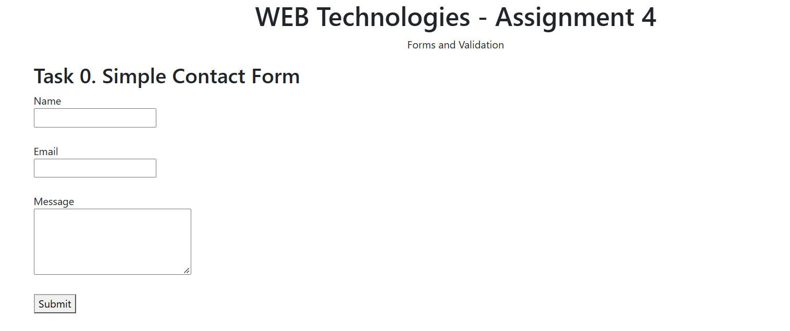
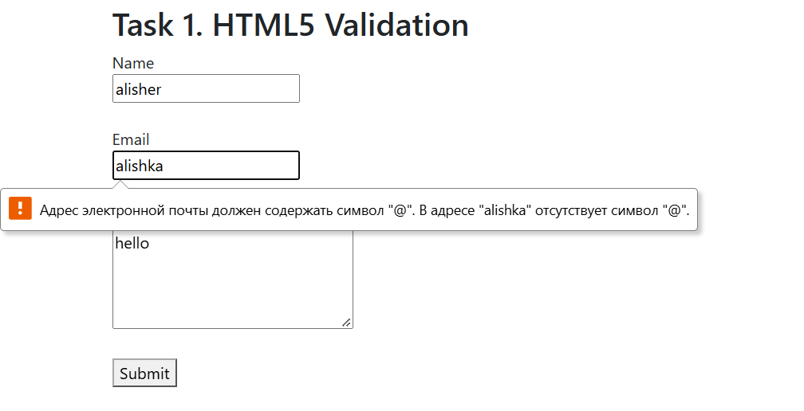
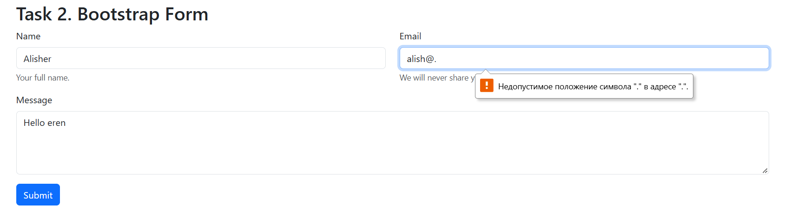
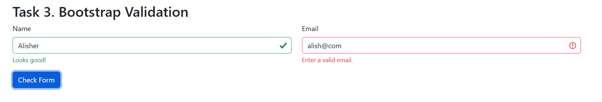
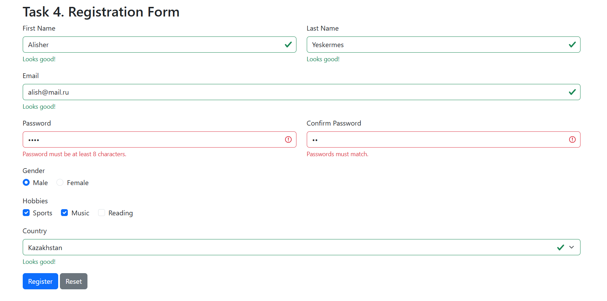

# Assignment #4 - Forms and Validation

Name: Alisher  
Group: IT-2501

Task 0. Simple Contact Form

Created a basic contact form with Name, Email, Message and Submit button.
All fields have labels.

Task 1. HTML5 Validation

Added required, type="email", minlength and maxlength attributes.
Tested empty fields and invalid email addresses.

Task 2. Bootstrap Form Styling

Used Bootstrap form classes, placeholders, helper text and the grid system.
The form layout is responsive.

Task 3. Bootstrap Validation Styles

Added Bootstrap validation feedback and JavaScript.
Invalid fields display error messages and valid fields display success messages.

Task 4. Registration Form

Created a registration form with First Name, Last Name, Email, Password,
Confirm Password, Gender, Hobbies and Country.

Added HTML5 validation, password matching, Bootstrap feedback, Submit and Reset buttons.

Work Summary

First, I created the HTML forms. Then I added Bootstrap classes and CSS.
After that, I added validation and password matching using JavaScript.
Finally, I tested the forms and took screenshots.